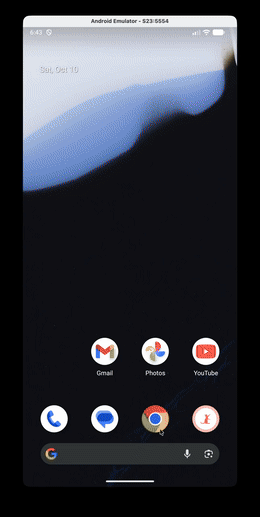
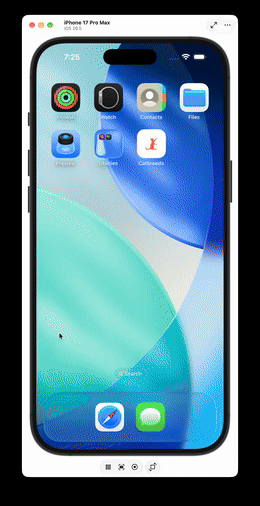

# Catbreeds - Mobile App


Aplicación móvil multiplataforma desarrollada para la prueba técnica de **Pragma**, consumiendo la API de [TheCatAPI](https://thecatapi.com/).

---

## 📱 Demostración

<table align="center">
  <thead>
    <tr>
      <th align="center">🤖 Android</th>
      <th align="center">🍏 iOS</th>
    </tr>
  </thead>
  <tbody>
    <tr>
      <td align="center" valign="top">
        <a href="docs/assets/android_demo.mp4">
          
        </a>
        <br />
        <a href="docs/assets/android_demo.mp4">🎬 Ver video completo (MP4)</a>
      </td>
      <td align="center" valign="top">
        <a href="docs/assets/ios_demo.mp4">
          
        </a>
        <br />
        <a href="docs/assets/ios_demo.mp4">🎬 Ver video completo (MP4)</a>
      </td>
    </tr>
  </tbody>
</table>

---

## 🎯 Alcance

- **Splash Screen**: Pantalla de carga nativa y web con animación e inicialización en segundo plano.
- **Landing / Catbreeds**:
    - Listado de razas con imagen, país de origen, inteligencia y enlace _"Más..."_.
    - Búsqueda en tiempo real con debounce.
    - Pull-to-refresh nativo y carga progresiva (`ion-infinite-scroll`) con renderizado optimizado (`content-visibility: auto`).
    - Selector de tema Claro / Oscuro / Sistema persistente con `@capacitor/preferences`.
- **Detalle de Raza**:
    - Mitad superior fija con imagen que no hace scroll (45vh).
    - Mitad inferior con scroll independiente (descripción, país, barras de progreso de inteligencia y adaptabilidad, esperanza de vida y temperamento).
- **Arquitectura & Estado**:
    - Angular 22 Zoneless con Signals y `httpResource`.
    - Interceptor HTTP funcional para inyección de `x-api-key`.
    - Estado global reactivo con `@ngrx/signals`.

---

## 🛠️ Tecnologías

- **Móvil**: Ionic 9 + Capacitor 8
- **Frontend**: Angular 22 (Standalone Components, Signals, Zoneless)
- **Gestión de Estado**: @ngrx/signals 22
- **Testing**: Vitest 4 (51 pruebas unitarias automatizadas)
- **Calidad de Código**: ESLint, Prettier, Commitlint, Lefthook

---

## ⚡ Guía Rápida de Utilización

### Prerrequisitos

- Node.js >= 20
- npm >= 10
- JDK 21 & Android Studio (para Android) / macOS & Xcode (para iOS)

### 1. Clonar e Instalar

```bash
git clone https://github.com/gacc94/mobile-pragma.git
cd mobile-pragma
npm install
```

### 2. Ejecutar en Web

```bash
npm start
```

> Abrir en el navegador en `http://localhost:4200/`.

### 3. Ejecutar en Android

```bash
# Compilar recursos web y sincronizar con Android
npm run build
npx cap sync android

# Abrir en Android Studio
npx cap open android

# O compilar directamente el APK Debug por consola:
cd android && ./gradlew assembleDebug
# APK generado en: android/app/build/outputs/apk/debug/app-debug.apk
```

### 4. Ejecutar en iOS

```bash
# Compilar recursos web y sincronizar con iOS
npm run build
npx cap sync ios

# Abrir en Xcode (requiere macOS)
npx cap open ios
```

### 5. Pruebas Unitarias y Calidad

```bash
npm test -- --watch=false   # Ejecutar 51 pruebas unitarias
npm run lint                # Linter ESLint
npm run format:check        # Verificación de formato Prettier
npm run build               # Compilación de producción
```
